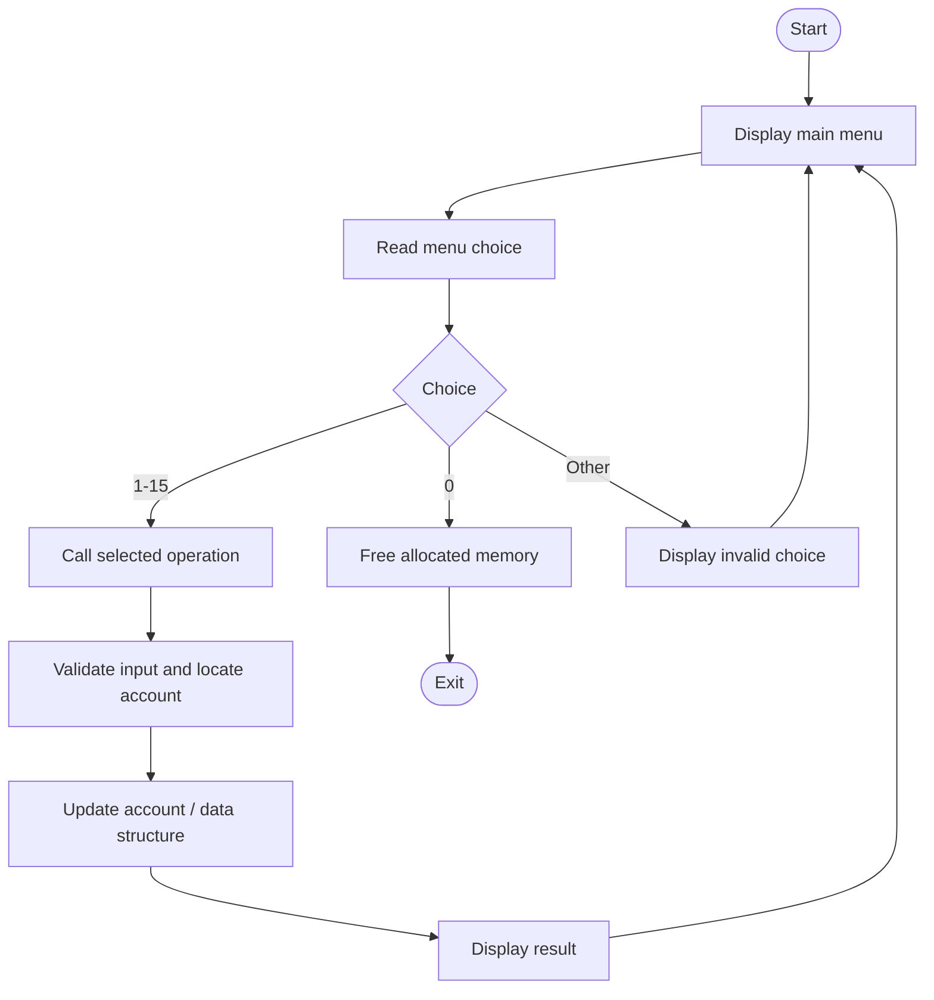
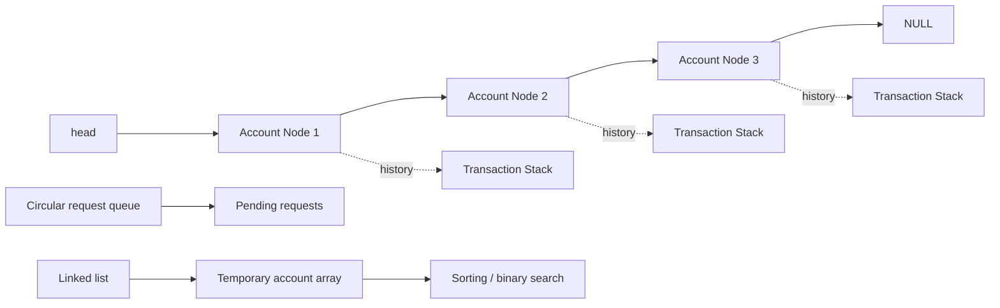

# Project Documentation
## Bank Account Management System

**Subject:** Data Structures Laboratory  
**Language:** C++  
**Application type:** Menu-driven console application

> Fill in the student, department, institution, academic year, and project-guide details required by your college before formal submission.

## Abstract

The Bank Account Management System is a menu-driven C++ application that demonstrates the practical use of fundamental data structures and algorithms. It supports account creation and deletion, deposits, withdrawals, transfers, balance enquiries, transaction history, undo of eligible transactions, account sorting and searching, compound-interest calculation, and processing of pending requests.

The program uses a singly linked list to store accounts, a linked stack for each account's transaction history, and a circular array-based queue for pending requests. It also uses a temporary array for sorting and binary searching. Bubble sort, selection sort, linear search, binary search, and recursion are demonstrated.

The application is designed for academic learning. It stores records in memory only and is not intended for real banking use.

## 1. Introduction

A bank account management application maintains basic account information and supports common account operations. This project implements a simplified console-based version in C++.

The project connects Data Structures concepts with a practical example. The linked list supports dynamic account nodes; stacks keep transaction histories; a circular queue manages pending requests in arrival order; and arrays are used as temporary storage for sorting and binary search.

## 2. Problem statement

To design and implement a menu-driven Bank Account Management System in C++ that manages account information and basic banking operations while demonstrating linked lists, stacks, queues, arrays, searching, sorting, and recursion.

## 3. Objectives

1. Create and maintain bank account records.
2. Perform deposits, withdrawals, and transfers.
3. Display the balance of a selected account.
4. Maintain and display transaction history.
5. Demonstrate stack operations through history and eligible undo functionality.
6. Demonstrate queue operations by adding and processing pending requests.
7. Sort account records using bubble sort and selection sort.
8. Search for an account using linear search and binary search.
9. Calculate compound interest using recursion.
10. Practice pointers and dynamic memory allocation/deallocation in C++.

## 4. Scope and features

- Create an account with a positive account number, non-empty holder name, and non-negative opening balance.
- Deposit a positive amount into an existing account.
- Withdraw a positive amount that does not exceed the available balance.
- Transfer a valid amount between two different existing accounts.
- Check an account balance.
- Display transaction history, newest transaction first.
- Undo the latest eligible deposit or withdrawal.
- Display all accounts.
- Display accounts sorted by account number or balance.
- Search for an account using binary search.
- Calculate projected compound interest recursively.
- Queue deposit and withdrawal requests and process them in FIFO order.
- Delete an account.

The program defines a maximum of 100 accounts and 50 pending requests.

## 5. Requirements

### Software

- C++ compiler such as `g++`.
- Terminal or command prompt.
- Source-code editor or IDE.

### Hardware

- General-purpose computer capable of running a C++ compiler.
- Keyboard and display.
- No special hardware is required.

## 6. System design

### 6.1 High-level architecture

### 6.2 Data structure relationships

Each account node contains an `Account` object, a pointer to the top of that account's transaction-history stack, and a pointer to the next account node. The queue is a separate circular array.

## 7. Data structures used

### 7.1 Account class / ADT

The `Account` class contains:

| Member | Type | Purpose |
|---|---|---|
| `accNo` | `int` | Account number |
| `name` | `string` | Account holder name |
| `balance` | `double` | Current balance |

It has constructors for initialization and a `display()` function.

### 7.2 Singly linked list

The `Node` structure stores the account data, a `Txn* history` pointer, and a `Node* next` pointer. The global pointer `head` refers to the first account node.

Functions using the list include `createAccount()`, `findAccount()`, `displayAll()`, `copyToArray()`, and `deleteAccount()`.

### 7.3 Stack

Each account has a transaction stack made of `Txn` nodes. A transaction stores its type, amount, and next pointer.

- `pushTxn()` adds at the top.
- `popTxn()` removes the top node.
- `showHistory()` displays newest to oldest.
- `undoLast()` reverses the latest eligible deposit or withdrawal.

The stack follows LIFO (Last In, First Out). Transfers are recorded as `Transfer Out` and `Transfer In`; the current undo function refuses to undo these entries.

### 7.4 Circular queue

The `Request` structure stores account number, request type (`D` or `W`), and amount. The circular queue is stored in `q[QMAX]` and managed by `qFront`, `qRear`, and `qCount`.

- `addRequest()` inserts at the rear.
- `processRequest()` removes the oldest request from the front.
- `qRear = (qRear + 1) % QMAX` wraps the rear index around the array.

The queue follows FIFO (First In, First Out).

### 7.5 Array

`copyToArray()` copies account records from the linked list into a temporary array. The array is used for sorting and binary search; the linked list remains the primary account store.

## 8. Algorithms

### 8.1 Linear search — `findAccount(int no)`

1. Start at `head`.
2. Compare the current account number with the requested number.
3. Return the current node if it matches.
4. Otherwise move to the next node.
5. Return `NULL` if the end is reached.

Time complexity: `O(n)`.

### 8.2 Bubble sort — `bubbleSortByAccNo(Account arr[], int n)`

1. Compare adjacent account numbers.
2. Swap adjacent account records when they are in descending order.
3. Repeat passes until the array is sorted in ascending account-number order.

Time complexity in this implementation: `O(n²)`.

### 8.3 Selection sort — `selectionSortByBalance(Account arr[], int n)`

1. Consider the current position as the position for the highest remaining balance.
2. Find the maximum balance in the unsorted portion.
3. Swap that record into the current position.
4. Repeat for the remaining positions.

Output order: highest balance first. Time complexity: `O(n²)`.

### 8.4 Binary search — `binarySearch(Account arr[], int n, int key)`

1. Set `low` to zero and `high` to `n - 1`.
2. Find the middle index.
3. Return the middle index if its account number matches the key.
4. If the key is greater, continue in the right half.
5. Otherwise continue in the left half.
6. Return `-1` if no match exists.

Binary search requires sorted input. `binarySearchAccount()` therefore copies the linked list to an array and bubble-sorts it by account number first.

Binary search itself: `O(log n)`. Complete menu operation: `O(n²)` due to bubble sort.

### 8.5 Recursive compound interest — `compound(double amount, double rate, int years)`

The function repeatedly applies the annual interest factor:

`compound(amount, rate, years) = compound(amount * (1 + rate / 100), rate, years - 1)`

Base case: when `years == 0`, return `amount`.

Time complexity: `O(years)`. Recursive call-stack space: `O(years)`. The calling function accepts years from 0 to 100.

## 9. Main functions

| Function | Responsibility |
|---|---|
| `readInt()` | Reads an integer and recovers from invalid formatted input |
| `readDouble()` | Reads a numeric value and recovers from invalid formatted input |
| `createAccount()` | Validates and inserts an account |
| `findAccount()` | Searches the linked list |
| `doDeposit()` | Updates balance and pushes a deposit transaction |
| `doWithdraw()` | Updates balance and pushes a withdrawal transaction |
| `depositMoney()` | Handles deposit interaction |
| `withdrawMoney()` | Handles withdrawal interaction |
| `transferMoney()` | Transfers between two accounts |
| `checkBalance()` | Displays an account balance |
| `pushTxn()` / `popTxn()` | Stack insertion and removal |
| `showHistory()` | Displays transaction history |
| `undoLast()` | Reverses the latest eligible deposit or withdrawal |
| `deleteAccount()` | Removes an account and frees its history |
| `freeAll()` | Frees remaining allocated account and transaction nodes |
| `displayAll()` | Displays all account records |
| `copyToArray()` | Copies list data into a temporary array |
| `bubbleSortByAccNo()` | Sorts by account number |
| `selectionSortByBalance()` | Sorts by descending balance |
| `binarySearch()` | Searches a sorted array |
| `interestCalc()` / `compound()` | Calculates compound interest |
| `addRequest()` | Enqueues a pending request |
| `processRequest()` | Processes the oldest pending request |

## 10. Menu options

| Choice | Operation |
|---:|---|
| 1 | Create account |
| 2 | Deposit |
| 3 | Withdraw |
| 4 | Transfer |
| 5 | Check balance |
| 6 | Transaction history |
| 7 | Undo last transaction |
| 8 | Display all accounts |
| 9 | Display sorted by account number |
| 10 | Display sorted by balance |
| 11 | Search account using binary search |
| 12 | Interest calculator using recursion |
| 13 | Add request to queue |
| 14 | Process next request |
| 15 | Delete account |
| 0 | Exit |

## 11. Complexity analysis

Let `n` be the number of accounts and `h` be the number of transactions in one account's history.

| Operation | Time complexity | Reason |
|---|---:|---|
| Find account | `O(n)` | Linked-list traversal |
| Create account | `O(n)` | Duplicate check and traversal to end |
| Display all accounts | `O(n)` | Visits every account |
| Delete account | `O(n + h)` | Find node and free its history |
| Deposit / withdrawal | `O(n)` | Account lookup dominates; stack push is `O(1)` |
| Transfer | `O(n)` | Two linked-list lookups |
| Push / pop transaction | `O(1)` | Operates at stack top |
| Display transaction history | `O(h)` | Traverses history |
| Bubble sort | `O(n²)` | Nested passes |
| Selection sort | `O(n²)` | Repeated maximum scans |
| Binary search alone | `O(log n)` | Halves search range |
| Binary-search menu operation | `O(n²)` | Bubble sort is performed first |
| Enqueue / dequeue | `O(1)` | Circular-array index updates |
| Compound interest recursion | `O(years)` | One recursive call per year |

## 12. Validation and memory management

The code checks that account numbers are positive and unique, names are non-empty, opening balances are non-negative, deposits and withdrawals are positive, withdrawals and transfers do not exceed available balance, and transfers use two different existing accounts.

It enforces the account and queue capacities. The interest calculator rejects negative rates and years outside 0–100. The numeric input helpers clear invalid input state and discard the invalid line.

Transaction-history nodes are freed when an account is deleted. `freeAll()` frees remaining account nodes and their transaction histories on normal program exit.

## 13. Testing checklist

Use these as manual test cases and record the actual observed result during your own run.

| Test | Action | Expected result |
|---|---|---|
| Account creation | Enter a new positive number, name and valid balance | Account created |
| Duplicate account | Reuse an existing account number | Duplicate rejected |
| Invalid account number | Enter zero or a negative number | Rejected |
| Deposit | Deposit a positive amount | Balance increases |
| Invalid deposit | Enter zero or negative amount | Rejected |
| Withdrawal | Withdraw within available balance | Balance decreases |
| Excess withdrawal | Withdraw more than available balance | Rejected |
| Transfer | Transfer between two different existing accounts | Both balances update |
| Same-account transfer | Use the same source and destination | Rejected |
| History | Display an account with transactions | Latest transaction shown first |
| Undo deposit | Undo a latest deposit when balance permits | Deposit reversed |
| Undo withdrawal | Undo a latest withdrawal | Amount added back |
| Sort by account number | Select option 9 | Ascending account-number order |
| Sort by balance | Select option 10 | Highest balance first |
| Binary search | Search for an existing account | Matching account displayed |
| Queue processing | Enqueue multiple valid requests and process them | FIFO order |
| Account deletion | Delete an existing account | Account and its history removed |

## 14. Limitations

1. Account and queue information are stored in memory and are lost after program exit.
2. No database or file-based persistence is implemented.
3. The application has a console interface only.
4. It is an academic demonstration, not a production banking system.
5. Account capacity is 100 and queue capacity is 50.
6. Transfer transactions cannot be undone by the current undo function.
7. Authentication, encryption, role-based access, and production audit controls are not implemented.

## 15. Future enhancements

- Persistent storage using files or a database.
- Authentication and user roles.
- GUI-based interface.
- Transaction date and time.
- Account statements and reports.
- Safe transfer reversal that updates both accounts consistently.
- Automated tests and expanded input validation.

## 16. Conclusion

The Bank Account Management System demonstrates how linked lists, stacks, queues, arrays, searching, sorting, and recursion can be applied in a practical C++ program. It supports basic account operations while providing hands-on experience with pointers, dynamic memory allocation, algorithm design, and modular programming.

## 17. References

1. Data Structures Laboratory course notes and practical material.
2. C++ reference material used during implementation.
3. Data Structures and Algorithms textbook prescribed or consulted for the course.

---

**Prepared from:** `src/ds_miniproject.cpp` supplied for this project.  
**Before submission:** Add student and institution details, genuine execution screenshots, and actual test observations.
